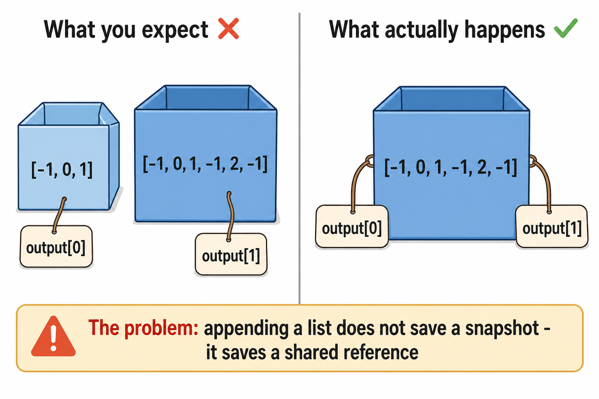
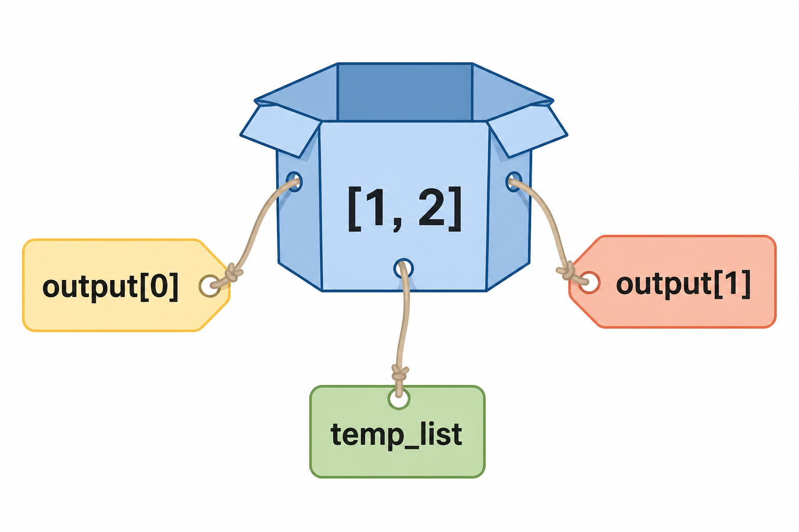
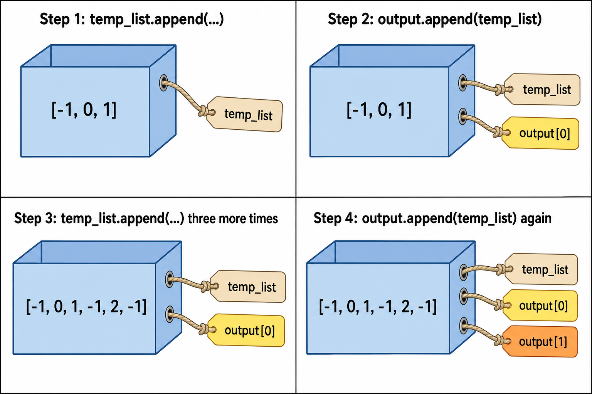

# Python / Programming Mechanics Glossary — QnA

**Scope: language mechanics, not DSA reasoning** (how Python actually executes — references, mutation, scope, syntax gotchas). DSA problem-reasoning vocabulary (order vs position, etc.) lives in `.cursor/skills/dsa-socratic-coach/glossary.md` instead.

Consulted when a real code bug traces back to a language-mechanics misunderstanding — not part of a DSA concept quiz. Keep these two glossaries separate: a DSA revision session should never pull from this file, and vice versa.

---

## Reference vs Copy (mutable list aliasing)

**1. The problem, before any explanation:**



You expect `output.append(temp_list)` at two different times to save two independent snapshots. It doesn't — both entries end up pointing at the same, currently-mutating list, so they always show identical, current content.

**2. Why this happens — mental model:**

**Mental model — labels on a box:** `output[0]`, `output[1]`, and `temp_list` can all be **labels taped onto the same box**. There is only **one box**. Writing a new value inside it shows up on every label — not because an update "traveled" from label to label, but because they were always pointing at the same box. There are no snapshots and no separate "previous instances" — just one mutable object with multiple names.



**3. Step-by-step — the actual `append` calls, and why old entries mutate:**



Step 1: `temp_list.append(...)` fills the box with `[-1, 0, 1]`. Step 2: `output.append(temp_list)` ties a **second** tag (`output[0]`) to that *same* box — no new box created. Step 3: three more `temp_list.append(...)` calls grow the box's contents to `[-1, 0, 1, -1, 2, -1]` — and **both** tags, including the "already appended" `output[0]`, now show the bigger list, because they were never separate. Step 4: `output.append(temp_list)` again just ties a **third** tag (`output[1]`) to that one box.

**Q: When you `output.append(temp_list)`, what actually gets stored in `output`?**
A: A **pointer** to `temp_list` — the same object in memory. Not a snapshot of its current contents.

**Q: If you keep appending to `temp_list` after that, does the entry already inside `output` change?**
A: Yes. `output`'s entry **is** `temp_list`, not a copy of it. Any later mutation of `temp_list` shows up there too, because there's only **one** underlying list object.

**Q: I appended `temp_list` to `output` twice (once per found triplet), then called `temp_list.clear()`. Why did every entry in `output` become `[]`?**
A: All those entries were pointers to the **same** object. Clearing it clears what every pointer sees — there was never more than one real list.

**Q: I printed `output` right after the first append and saw `[[-1, 0, 1]]`. Later I printed again and that first entry had changed. How, if I never touched `output[0]` directly?**
A: The first print was accurate **for that instant** — `temp_list` really was `[-1, 0, 1]` then. But `output[0]` was never a frozen snapshot; it's a live reference to `temp_list`. By the second print, `temp_list` had grown (more values appended, never cleared), so **every** slot pointing to it — old and new — shows the current, larger value simultaneously.

**Q: Minimal proof of this?**
```python
temp = []
output = []

temp.append(1)
output.append(temp)
print(output)  # [[1]]

temp.append(2)
output.append(temp)
print(output)  # [[1, 2], [1, 2]]  <- the "old" entry changed too
```

**Q: How do you actually store an independent snapshot, so later mutations don't leak backward?**
A: Give `output` a **new** list object each time, instead of reusing/mutating one shared list. (Several ways to get a new object — the point to lock is *why* you need one, not memorizing a single syntax.)

**Q: Does this only apply to lists?**
A: It applies to any **mutable** object (lists, dicts, sets, custom objects). It does *not* apply to immutable values (numbers, strings, tuples) — those can't be mutated after creation, so this aliasing surprise doesn't happen with them.

**Q: What's actually happening in memory to make this true — how are lists and ints stored differently?**
A: See [`list/list-internals.md`](list/list-internals.md) — objects-first construction, tag = reference = memory address, and why mutability (not "listness" specifically) is the real dividing line.

---

## Set and tuple (membership, hashable)

Runnable example: [`set_and_tuple.py`](set_and_tuple.py). Run it when revising this topic.

**Hash (why the set is fast):** [`hash_in_sets.py`](hash_in_sets.py) — fingerprint, lockers, why `list` is unhashable, why sort-then-`tuple` matters.

**Q: What is a hash?**
A: A **fingerprint number** of a value (`hash(x)`). Same value → same fingerprint (in one run). A set uses it to jump to one “locker,” not walk every item like `.count()`.

**Q: Is hash the same as a memory address / tag on a box?**
A: No. Address = *where* an object lives. Hash = *fingerprint of the value* so a set knows which locker to open.

**Q: What is a `set` for?**
A: Unique items and a fast “is this already here?” (`x in seen`), instead of walking a list with `.count()`.

**Q: What does hashable mean?**
A: “Allowed in a `set`.” The value’s fingerprint must not change. `int`, `str`, `tuple` of hashables: yes. `list`: no (it can `.append` / `.clear`).

**Q: Why can’t a `list` be hashed? What happens if you `seen.add(temp_list)`?**
A: A list can change in place (`.append`, `.clear`). The hash is a fingerprint of the *current* contents. If the list changed after going in the set, the set would look in the wrong locker. Python therefore **refuses**: `TypeError: unhashable type: 'list'`. Use `tuple(...)` after you sort, not the list.

**Q: `int` is also “in” `nums` and `temp_list`. Why can `int` be hashed but `list` cannot?**
A: `int` is immutable — no in-place change, fingerprint stays honest. Sharing a reference to `-1` is safe. Sharing a reference to a list is dangerous because the box itself can grow/shrink.

**Q: Why `tuple(temp_list)` after sort, not the list itself?**
A: Same three numbers in a fixed order, and hashable. `seen.add(temp_list)` raises `TypeError`.

**Q: What is wrong with `if key not in set():` and `set.add(key)`?**
A: `set()` is a **new empty** set every time. `set.add` is the **type**, not your box. You create `seen = set()` **once**, then use `key not in seen` and `seen.add(key)`.

---

## `range` (start, stop, step)

Runnable: [`range_demo.py`](range_demo.py). `n = len(height)` first; then `range(n)` is the indexes. Never `n = range(height[])`.

**Mental model:** `range(start, stop, step)` is a **counter recipe**, not a list you stored. It yields `start`, then adds `step`, and **stops before** `stop` (the cutoff is never included).

**Q: What are start, stop, step in `range(n)`?**
A: `range(n)` means `range(0, n, 1)`. start `0`, stop **`n`** (cutoff), step `+1`. Last value you get is `n-1`, not `n`.

**Q: If `height` has 4 bars, what does `for idx in range(len(height))` walk?**
A: `0, 1, 2, 3`. `n = 4`, stop is `4`, last index is `3`.

**Q: Why is the last value `n-1` if stop is `n`?**
A: Stop is the wall you do **not** cross. Like `while i < n`.

**Q: What does `range(n - 1, -1, -1)` walk?**
A: start `n-1`, stop **before** `-1`, step `-1` → `n-1, n-2, …, 0`. Same as `j = n-1` then `j = j-1` while `j >= 0`.

**Q: Is `range(n)` a list of n numbers sitting in memory?**
A: No. It is a recipe that **produces** the next number when the `for` asks. (`list(range(n))` would build a real list if you need one.)

**Q: What is wrong with `n = range(height[])`?**
A: `height[]` is invalid, and `n` should be the **count** (`len(height)`). `range(...)` is the **walk**, not the length.

---

## `str.isalnum()` (letter or digit)

**Q: What does `ch.isalnum()` mean?**
A: “Is this character **alphanumeric**?” — a **letter** or a **digit**. `'A'`, `'z'`, `'3'` → `True`. `' '`, `','`, `':'` → `False`. It is a method on that one character (a 1-length string), not regex, not `RegexFlag`.

**Q: How do you say “is NOT alnum”?**
A: There is no `.isnotalnum()`. Use `not ch.isalnum()` (or `not s[index].isalnum()`). `not` flips True/False.

---

## `dict` (notebook: key → something)

**Q: What is a `dict`?**
A: A notebook of **key → value**. `seen = {}` is empty. `seen[3] = 0` writes “value `3` lives at index `0`.” `need in seen` is True if that key is already written. `seen[need]` is the stored index. Not a `set` (a set has no second column).

**Q: `if need is in the seen` — valid Python?**
A: No. Use `if need in seen:`.


---

## String slice `s[i:]`

**Where it showed up:** longest unique run v2 — drop the prefix through the old copy.

**Q: What is `sub_string[old + 1 :]`?**
A: A **new** string: every character from index `old + 1` through the **end**. Index `old` and everything before it are gone. Empty if `old + 1` is past the last index (`"pw"[2:]` is `""`).

---

## List `.remove(value)` vs position (slots slide)

**Where it showed up:** course prereqs — `not_taken.remove(idx)` when `idx` was the **slot**, not the course.

Runnable: [`list/remove_vs_index.py`](list/remove_vs_index.py).

**Mental model:** A list is a row of **slots**. Slot `0` is the first box. `.remove(x)` searches for the **number `x`** and deletes that box. `.pop(i)` deletes **slot `i`**. After a delete, everything to the right **slides left**. The old slot `i+1` is now slot `i`.

**Q: `not_taken = [0, 1, 2]`, `idx = 1`. What does `not_taken.remove(idx)` delete?**
A: The **value** `1`, not “whatever is in slot 1” as a rule. Here slot 1 happens to be `1`, so it looks right. After you already removed `0`, `not_taken` is `[1, 2]` and `idx = 1`: `remove(1)` deletes course `1` while slot 1 is course `2`.

**Q: How do you delete the course you are looking at?**
A: `course = not_taken[idx]` then `not_taken.remove(course)`, or `not_taken.pop(idx)`. You remove **that course** (or that slot), not the integer `idx` unless `idx` really is the course number you want gone.

**Q: After you remove at `idx`, should you do `idx = idx + 1`?**
A: No. The next course **slid into** `idx`. Add `1` to `idx` only when you **skip** (list did not shrink at this slot).

**Q: `.remove(x)` if `x` appears twice?**
A: It deletes only the **first** match.

---

## `range` (1, 2, or 3 numbers)

**Where it showed up:** oranges minutes — `for k in range(length)`; print showed `range(0, 2)` not `[0, 1]`.

Runnable drills: [`range/1_one_number.py`](range/1_one_number.py), [`range/2_start_stop.py`](range/2_start_stop.py), [`range/3_step.py`](range/3_step.py), [`range/4_unseen.py`](range/4_unseen.py), [`range/5_walk_word_from_right.py`](range/5_walk_word_from_right.py). Demo: [`range_demo.py`](range_demo.py).

**Mental model:** `range` is a counter instruction, not a printed list. **Stop is a cutoff — never included.**

**Q: Does `range` always take 3 inputs?**
A: No. **1, 2, or 3.** `range(n)` = `range(0, n, 1)`. `range(start, stop)`. `range(start, stop, step)`. Zero inputs is an error.

**Q: What are start, stop, step?**
A: **start** = first `k`. **stop** = cutoff, never a value of `k`. **step** = add this each trip (increment). Negative step counts down.

**Q: `print(range(2))` shows `range(0, 2)`. Is that the numbers `0` and `2`?**
A: No. It means start `0`, stop `2`. The `for` gets `k = 0`, then `k = 1`. Two trips. You never get `k = 2`. Use `list(range(2))` if you want to see `[0, 1]`.

**Q: `for k in range(length)` — do you need `k = k + 1` inside?**
A: No. The `for` already moves `k` each trip.

**Q: Walk `"wrt"` from the right. Why `range(-1, -len(w), -1)` not `range(-1, -len(w)-1, -1)`?**
A: `k` is the right letter of a pair. Last `k` is `-2` so `k-1` is `-3` (first letter). If `k` became `-3`, `w[-4]` crashes. Stop is `-len(w)`. Same pairs: `range(len(w)-1, 0, -1)`. `k` is the slot, not the step. `-1` is last; `-n` is first.

---

## `KeyError` (`d[x]` when `x` is not in the dict)

**Where it showed up:** letter order Job 2 — `depends[x]: []` then `depends[x].append(...)`.

**Q: What does `KeyError: 'e'` mean?**
A: You asked the dict for key `'e'`. That key is not stored. The letter `'e'` is just which key you asked for.

**Q: Why didn’t `depends[x]: []` create the key?**
A: `:` does not store. `=` stores. Use `depends[x] = []` (same as `links[... ] = []`), then `.append`.

---

*(Add more language-mechanics terms below as they come up — one QnA block per term, same style. DSA-reasoning terms go in the skill's glossary.md instead.)*

