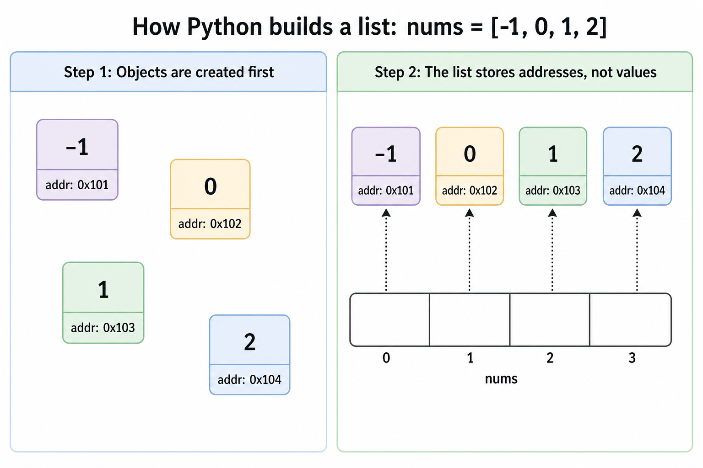
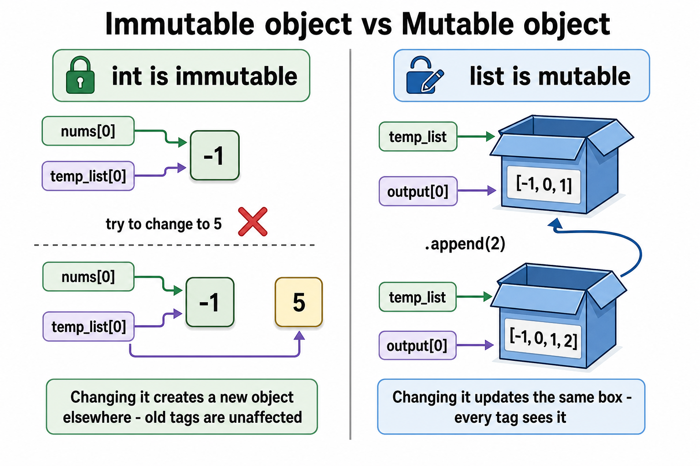

# Python Lists — Internals (objects, addresses, mutability)

Companion to `../glossary-python.md` (the append/reference-aliasing bug). This note covers the internals *underneath* that bug: how a list is actually built in memory, and why only mutable objects can cause it.

---

## 1. How a list is actually built

`nums = [-1, 0, 1, 2]` happens in two steps, not one:

**Step 1 — objects are created first.** Each value (`-1`, `0`, `1`, `2`) becomes its own object, living at its own memory address.

**Step 2 — the list stores addresses, not values.** `nums` is an array of **references** (pointers) — one per slot — each pointing at one of those objects. The list itself does not hold `-1`, `0`, `1`, `2` directly inside its own memory; it holds *arrows* to where those objects live.

**Vocabulary — three names, one thing:**

| Word | Level |
|---|---|
| **Tag** | our analogy word (box diagrams) |
| **Reference** / **pointer** | the real technical term — say this in an interview |
| **Memory address** | what a reference literally *is*, under the hood (CPython) |

`nums[0]` holds a **reference** (implemented as a **memory address**) to the object `-1`. Not a copy — nothing about `-1` is duplicated.

**Bonus fact:** CPython caches small integers (roughly -5 to 256). So two `-1`s at different positions in the same list likely point to the **exact same** `-1` object, not two separate ones. Same value *and* same object — this is normal for small ints, not a bug.

---

## 2. Why only mutable objects cause the aliasing bug

**int is immutable:** `nums[0]` and `temp_list[0]` can both point at the same `-1`. If you "change" one of them (e.g., `temp_list[0] = 5`), you don't edit `-1` in place — you point that one tag at a **brand-new** `5` object elsewhere. The other tag (`nums[0]`) still points at the original, untouched `-1`. Nothing "leaks" between them, because there's no operation that mutates an int after it's created.

**list is mutable:** `temp_list` and `output[0]` can both point at the *same* list box. `.append(2)` **does** edit that box in place — it doesn't create a new box. So every tag pointing at that box — old and new — sees the update. This is the entire root cause of the `output.append(temp_list)` bug in `../glossary-python.md`.

**The one-line takeaway:** sharing a reference is only dangerous when the thing being pointed at can be changed *in place*. Immutable targets (int, str, tuple) make sharing harmless. Mutable targets (list, dict, set) make sharing risky — you must consciously create a new object when you want an independent copy.

---

*(Add more list/object-internals terms here as they come up. Aliasing bug details and QnA stay in `../glossary-python.md`.)*
